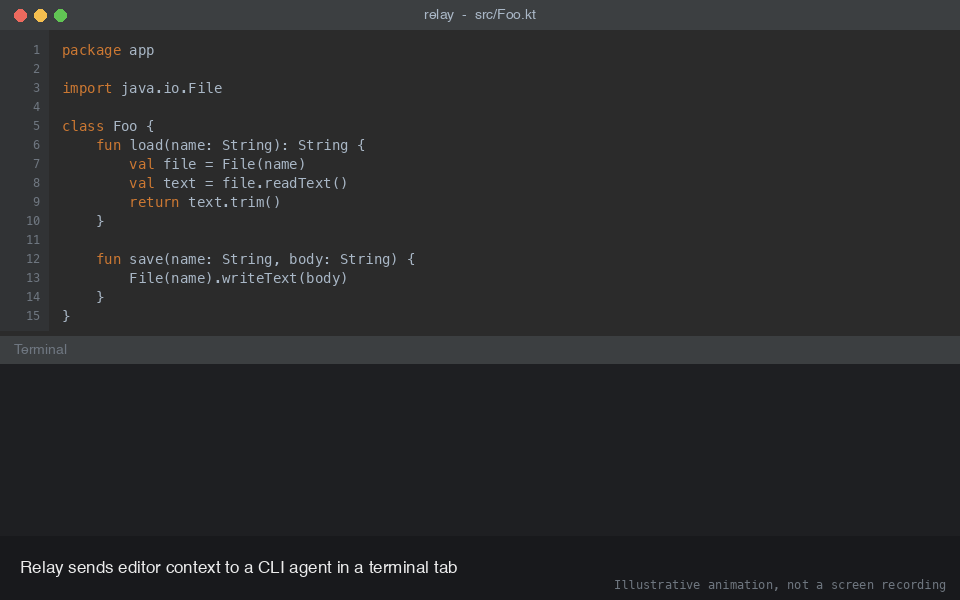

# Relay

Relay sends editor context (file paths and code selections) to a CLI coding agent running in a dedicated terminal tab. It ships once per editor platform. Each platform lives in its own folder, side by side.



_Illustrative animation, not a screen recording._

## Platforms

| Platform | Folder | Language | Build | Docs |
|---|---|---|---|---|
| JetBrains IDEs (IntelliJ IDEA, PyCharm, WebStorm, ...) | [`jetbrains/`](jetbrains/) | Kotlin | Gradle | [`jetbrains/README.md`](jetbrains/README.md) |
| VS Code | [`vscode/`](vscode/) | TypeScript | npm | [`vscode/README.md`](vscode/README.md) |

- The platforms are independent. Neither builds the other.
- Each folder has its own README, changelog, version, tests and build.
- Build, test and install steps are in each platform's README. This file does not repeat them.

## Repository structure

```
relay/
├── README.md                  this file: overview, shared behavior, structure
├── LICENSE                    MIT, covers all platforms
├── .gitignore                 ignore rules for every platform's build output
├── jetbrains/                 JetBrains plugin (Kotlin, Gradle)
│   ├── README.md              install, build, develop, test
│   ├── CHANGELOG.md
│   ├── build.gradle.kts       plugin build
│   ├── settings.gradle.kts
│   ├── gradle.properties      plugin version and target IDE
│   ├── gradlew, gradlew.bat, gradle/wrapper/
│   ├── .run/                  IDE run configs (Run Plugin, Run Tests, Run Verifications)
│   ├── media/                 demo GIF and step images
│   ├── releases/              prebuilt relay-<version>.zip and SHA256SUMS
│   └── src/
│       ├── main/kotlin/com/example/sendtoterminal/
│       │   ├── *Action*.kt        editor actions and per-agent actions
│       │   ├── TerminalSender.kt  tab lifecycle, target choice, paste
│       │   ├── StaleRelayTabCleaner.kt
│       │   ├── format/            agent detection and reference formats
│       │   └── settings/          saved settings and settings screen
│       ├── main/resources/META-INF/plugin.xml
│       └── test/kotlin/...        unit tests for format/
└── vscode/                    VS Code extension (TypeScript, npm)
    ├── README.md              install, settings, develop, test (Marketplace page)
    ├── CHANGELOG.md
    ├── package.json           extension manifest, commands, settings, version
    ├── tsconfig.json
    ├── .vscode/               F5 launch and build tasks
    ├── .vscodeignore          files left out of the packaged .vsix
    ├── media/                 demo GIF, step images and the extension icon
    ├── releases/              prebuilt relay-vscode-<version>.vsix and SHA256SUMS
    ├── scripts/run-integration.js
    ├── test-fixtures/workspace/   sample project the integration test opens
    └── src/
        ├── extension.ts       commands and status bar
        ├── sender.ts          terminal lifecycle, target choice, paste
        ├── settings.ts        reads relay.* settings
        ├── format.ts          agent detection and reference formats
        ├── test/              unit tests for format.ts
        └── integration/       end-to-end scenario run inside VS Code
```

| Rule | Detail |
|---|---|
| One folder per platform | Source, build files, tests, README, changelog and media for a platform stay inside its folder. |
| Nothing shared in code | `jetbrains/` and `vscode/` share no source. They share behavior, written down in this file. |
| Open one folder at a time | Open `jetbrains/` in IntelliJ IDEA and `vscode/` in VS Code. Opening the repo root works for browsing, but the Gradle and npm projects are not at the root. |
| Run commands in the platform folder | Run `./gradlew ...` inside `jetbrains/` and `npm ...` inside `vscode/`. |
| Same names across platforms | The same pieces have the same job: `TerminalSender` and `sender.ts` choose the terminal, `format/` and `format.ts` build the reference text. |

What is not in the repository:

| Item | Why |
|---|---|
| `build/`, `.gradle/`, `.kotlin/`, `.intellijPlatform/` | JetBrains build output and sandbox, ignored |
| `node_modules/`, `out/`, `*.vsix` outside `releases/` | VS Code build output, ignored. `releases/*.vsix` is tracked on purpose. |
| `.idea/`, `.local/`, `.cursor/`, `.junie/`, `.DS_Store` | Personal tooling and editor state, ignored |
| CI workflows | None yet for this layout |

## What Relay does

1. You press a shortcut in the editor.
2. Relay picks the target terminal: the active Relay terminal, else the last Relay terminal you used, else a new one for the default agent.
3. Relay starts that agent's command in the terminal, once.
4. Relay pastes a reference to your file or selection into the agent prompt, formatted for that agent. It does not press Enter.

| Input | Transform | Output |
|---|---|---|
| Active file | Project-relative path, formatted for the agent | `@src/Foo.kt` |
| Selected lines | Path plus line range, formatted for the agent | `@src/Foo.kt#L10-L20` |
| Agent profile | Command run in the terminal on first use | Running agent session |

A selection sends a reference, not the code. The agent reads the lines from the saved file.

## Shared behavior

Both platforms use the same terminal names, default keys and reference formats.

| Action | Default key |
|---|---|
| Open or focus Relay | `Ctrl+Alt+T` |
| Send file path | `Ctrl+Alt+P` |
| Send selection | `Ctrl+Alt+Enter` |

Reference formats for file `src/Foo.kt` and lines 10 to 20:

| Agent or mode | File reference | Selection reference |
|---|---|---|
| Cursor (`auto`) | `@src/Foo.kt` | `@src/Foo.kt:10-20` |
| Claude Code (`auto`) | `@src/Foo.kt` | `@src/Foo.kt#L10-L20` |
| Aider, Goose, other (`auto`) | `@src/Foo.kt` | `@src/Foo.kt:10-20` |
| `add` | `/add @src/Foo.kt` | `@src/Foo.kt:10-20` |
| `read-only` | `/read-only @src/Foo.kt` | `@src/Foo.kt:10-20` |
| `at-mention`, `plain` | `@src/Foo.kt` | `@src/Foo.kt:10-20` |

- Agent kind comes from the profile name or the first word of its command.
- The JetBrains plugin also has a **Launch** column (Goose interactive or plain). VS Code does not.

## Adding a new platform

Follow the same separation.

1. Create a folder named after the platform, for example `zed/`, next to `jetbrains/` and `vscode/`.
2. Keep everything for that platform inside it: source, build files, tests, `README.md`, `CHANGELOG.md`.
3. Use the shared key table and reference formats above.
4. Add a row to the **Platforms** table in this file.
5. Tag releases with the platform prefix, for example `zed-v1.0.0`.
6. Add the build output of the new platform to the root `.gitignore`.

## Install a prebuilt file

Installable files are committed so you can install without building. Full steps are in each platform's README.

| Platform | File | Install |
|---|---|---|
| JetBrains | [`jetbrains/releases/relay-1.5.0.zip`](jetbrains/releases/relay-1.5.0.zip) | **Settings → Plugins →** gear **→ Install Plugin from Disk...**, then restart. [Steps](jetbrains/README.md#install-manually-jetbrains) |
| VS Code | [`vscode/releases/relay-vscode-1.5.2.vsix`](vscode/releases/relay-vscode-1.5.2.vsix) | `code --install-extension relay-vscode-1.5.2.vsix`, or **Extensions → ... → Install from VSIX...**. [Steps](vscode/README.md#install-manually-vs-code) |

- Each `releases/` folder has a `SHA256SUMS` file. Check a download with `shasum -a 256 <file>`.
- Downloads from GitHub work once the repository is public.
- Files installed from disk are unsigned. Install only files you built or trust.

## Releases

| Platform | Tag | Version lives in | Release file |
|---|---|---|---|
| JetBrains | `jetbrains-v<version>` | `jetbrains/gradle.properties` | `jetbrains/releases/relay-<version>.zip` |
| VS Code | `vscode-v<version>` | `vscode/package.json` | `vscode/releases/relay-vscode-<version>.vsix` |

- Each release replaces the file in `releases/`. Keep only the newest file there. Older versions stay in git history.
- Release steps are in each platform's README.

Consequence: a release is only complete when the file in `releases/` matches the version in the manifest, so rebuild and replace the file in the same commit as the version bump.
