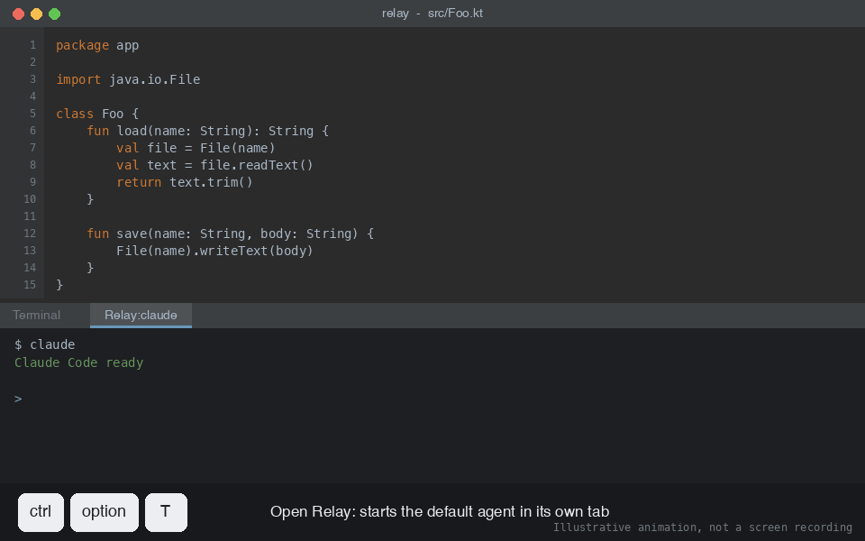
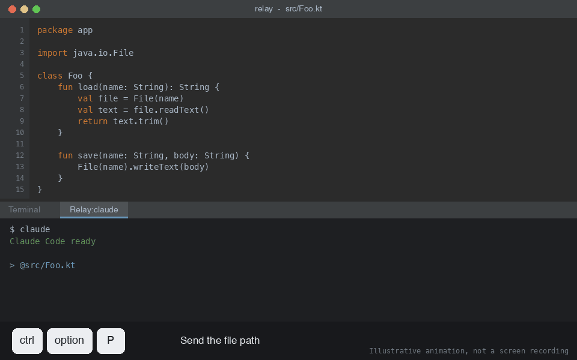
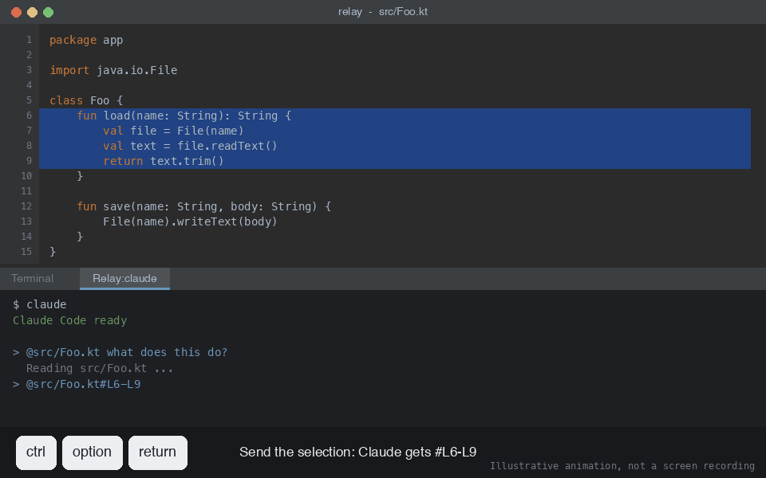
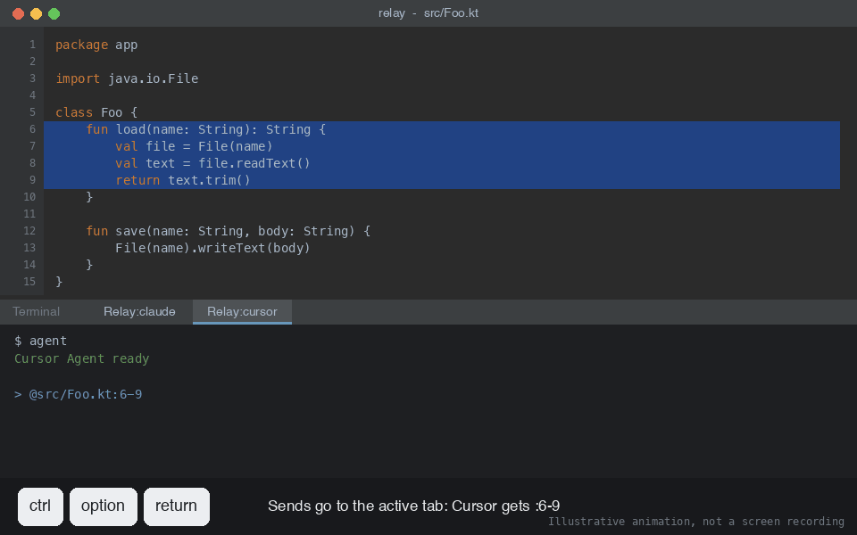
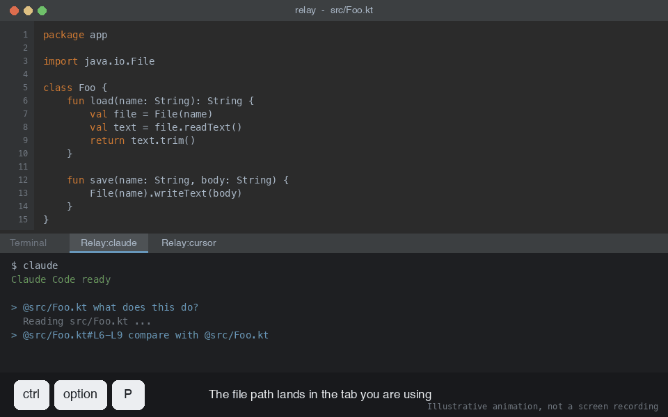

# Relay for JetBrains IDEs

Part of the [Relay repository](../README.md). The VS Code version is in [`../vscode`](../vscode/README.md).

Plugin ID: `com.sulsira.relay`. Language: Kotlin. Build: Gradle with the IntelliJ Platform Gradle Plugin.

## What it does

_Illustrative animation, not a screen recording._

1. You press a shortcut in the editor.
2. Relay picks the target tab: the selected Relay tab, else the last Relay tab you selected, else a new tab for the default agent.
3. Relay starts that agent's command in the tab, once.
4. Relay pastes a reference to your file or selection into the agent prompt, formatted for that tab's agent.

| Input | Transform | Output |
|---|---|---|
| Active file | Project-relative path, formatted for the agent | `@src/Foo.kt` |
| Selected lines | Path plus line range, formatted for the agent | `@src/Foo.kt#L10-L20` |
| Agent profile | Command run in the tab on first use | Running agent session |

## How it works, step by step

_Illustrations drawn for this README, not screen captures. Key labels use macOS names: `ctrl`, `option`._

### 1. Open Relay

Press `Ctrl+Alt+T`. A terminal tab named `Relay:claude` opens and runs the agent's command.

### 2. Send the file path

Press `Ctrl+Alt+P` with a file open. Relay pastes `@src/Foo.kt` into the agent prompt. It does not press Enter, so you can keep typing.

### 3. Send a selection

Select lines, then press `Ctrl+Alt+Enter`. Claude gets the line range as `@src/Foo.kt#L6-L9`.

### 4. Add a second agent

Press the shortcut you bound to `Open cursor` (for example `Ctrl+Alt+2`, set in the agents table or **Settings → Keymap → Relay**). A second tab opens. Each agent has its own tab. The same selection now goes out in that agent's format: `@src/Foo.kt:6-9` for Cursor.

### 5. Sends follow the active tab

Switch back to the Claude tab. The next file path lands there, in Claude's format. Relay uses the tab you last used, not a fixed default.

## Shortcuts

| Action | Shortcut | Source |
|---|---|---|
| Open Relay | `Ctrl+Alt+T` | `plugin.xml` action `SendToTerminal.Open` |
| Send file path | `Ctrl+Alt+P` | `plugin.xml` action `SendToTerminal.FilePath` |
| Send selection | `Ctrl+Alt+Enter` | `plugin.xml` action `SendToTerminal.Selection` |

- All actions live in the editor right-click menu under **Relay**.
- Rebind them in **Settings → Keymap**.

### Per-agent shortcuts

- Every agent profile gets an `Open <agent>` action. It has no default key.
- It opens or focuses that agent's own tab, creating it on first use. It does not change where sends go, except that the focused tab becomes the active one.
- Bind a key in **Settings → Tools → Relay**: double-click the **Shortcut** cell of the agent row. Or bind it in **Settings → Keymap → Relay**.
- A new agent needs **Apply** before its shortcut can be set.
- To remove a shortcut, select the agent row and click **Clear Shortcut** in the table toolbar.
- Renaming an agent drops its key, because the binding is tied to the agent name.

## Where sends go

| Situation | Target |
|---|---|
| A Relay tab is selected in the Terminal tool window | That tab |
| A non-Relay tab is selected (plain shell) | The last Relay tab you selected |
| No Relay tab is open | A new tab for the default agent |

- Several agents can run side by side, one tab each.
- Idle tabs keep running and receive nothing.
- The default agent only decides which agent starts when no Relay tab exists.

## Agent reference formats

Relay picks a format from the agent profile. Detection uses the profile name or the first token of the command (`format/AgentKind.kt`).

| Agent | Detected by | File reference | Selection reference |
|---|---|---|---|
| Cursor | name `cursor` or command `agent` | `@path` | `@path:start-end` |
| Claude Code | name or command `claude` | `@path` | `@path#Lstart-Lend` |
| Aider | name or command `aider` | `@path` | `@path:start-end` |
| Goose (interactive) | name or command `goose` | `@path` | `@path:start-end` |
| Generic | anything else | `@path` | `@path:start-end` |

- Override detection per profile with **Reference mode**: `Auto`, `Add` (`/add @path`), `Read-only` (`/read-only @path`), `@ mention`, `Plain`.
- Goose launch mode is `Auto`, `Interactive`, or `Plain`. `Auto` reads the command for `-s`, `--interactive`, and non-interactive subcommands such as `serve` or `recipe`.

## Configuration

1. Open **Settings → Tools → Relay**.
2. Add agent profiles: name, command, reference mode, launch mode, and an optional shortcut.
3. Set the default agent. You can also switch it from **Relay → Default Agent** in the editor menu.
4. Set the agent startup delay in ms. Relay waits this long after launching the agent before pasting.

### Agents table

| Column | Required | What it does | Accepted values |
|---|---|---|---|
| Name | Yes | Unique label. Becomes the tab title `Relay:<name>` and the action `Open <name>`. With `Auto` reference mode it also picks the format when it equals `cursor`, `claude`, `aider`, or `goose`. | Any unique text |
| Command | Yes | Shell command typed into the new tab once, to start the agent. | Any command, with flags |
| Reference | No, default `Auto` | How file and selection references are written for this agent. | `Auto`, `Add`, `Read-only`, `@ mention`, `Plain` |
| Launch | No, default `Auto` | Tells Relay whether a Goose command is an interactive session or a batch run. | `Auto`, `Interactive`, `Plain` |
| Shortcut | No, empty by default | Key that opens or focuses this agent's tab. Double-click to set. Clear with the toolbar button. | Any free keystroke |

Reference modes, for file `src/Foo.kt` and lines 10 to 20:

| Mode | File reference | Selection reference | Use for |
|---|---|---|---|
| `Auto` | By agent kind, see the format table above | By agent kind | Most setups |
| `Add` | `/add @src/Foo.kt` | `@src/Foo.kt:10-20` | Aider-style `/add` |
| `Read-only` | `/read-only @src/Foo.kt` | `@src/Foo.kt:10-20` | Aider-style read-only context |
| `@ mention` | `@src/Foo.kt` | `@src/Foo.kt:10-20` | Agents that use `@` mentions |
| `Plain` | `@src/Foo.kt` | `@src/Foo.kt:10-20` | Anything else |

- Launch only changes behavior for Goose, and today `Interactive` and `Plain` produce the same references (`@path`, `@path:start-end`). Treat it as reserved for future formats.
- An agent whose name and command token match no known agent uses the generic format (`@path`, `@path:start-end`) under `Auto`.

### Example agents

| Name | Command | Reference | Launch | Shortcut | Result for file `src/Foo.kt`, lines 10 to 20 |
|---|---|---|---|---|---|
| `claude` | `claude` | `Auto` | `Auto` | `Ctrl+Alt+1` | File `@src/Foo.kt`. Selection `@src/Foo.kt#L10-L20`. |
| `cursor` | `agent` | `Auto` | `Auto` | `Ctrl+Alt+2` | File `@src/Foo.kt`. Selection `@src/Foo.kt:10-20`. |
| `aider` | `aider --model sonnet` | `Add` | `Auto` | none | File `/add @src/Foo.kt`. Selection `@src/Foo.kt:10-20`. |
| `goose` | `goose session` | `Auto` | `Interactive` | none | File `@src/Foo.kt`. Selection `@src/Foo.kt:10-20`. |
| `review` | `claude --model opus` | `@ mention` | `Auto` | `Ctrl+Alt+3` | File `@src/Foo.kt`. Selection `@src/Foo.kt:10-20`. |

- The `review` row shows a second profile for the same CLI. Names must be unique, but commands may repeat.
- A name that is not a known agent, such as `review`, needs a Reference mode to get the format you want. With `Auto` the command `claude` still selects the Claude format.
- The shortcut keys are examples. Relay assigns none by default.

## Behavior details

- Relay tracks its tabs by object identity, not title (`TerminalSender.kt`). A shell that rewrites the tab title does not cause a duplicate tab.
- Each tab remembers the agent profile it was created with. Edited reference or launch modes apply on the next send.
- Relay tabs restored from a previous IDE session are closed on startup (`StaleRelayTabCleaner.kt`). Their shell and agent are gone, so the next send opens a fresh tab.
- A tab closed by hand is dropped from tracking on the next send.
- Text is pasted with bracketed paste mode and not submitted. You review it, then press Enter.
- Paths are relative to the content root of the file. If none exists, the absolute path is used.

## Requirements

- IDE build `253` or newer (2025.3+). Upper bound is open.
- Bundled Terminal plugin `org.jetbrains.plugins.terminal`.
- Works in IntelliJ IDEA, PyCharm, WebStorm, and other IDEs that ship the Terminal plugin.
- JDK for Gradle builds.

## Project layout

| Path | Role |
|---|---|
| `src/main/resources/META-INF/plugin.xml` | Plugin metadata, actions, shortcuts, settings registration |
| `.../sendtoterminal/OpenTerminalAction.kt` | Open or focus action |
| `.../sendtoterminal/SendFilePathToTerminalAction.kt` | Send file path action |
| `.../sendtoterminal/SendSelectionToTerminalAction.kt` | Send selection action |
| `.../sendtoterminal/OpenAgentActions.kt` | Per-agent `Open <agent>` actions, registered from the agent list |
| `.../sendtoterminal/OpenAgentActionsStartup.kt` | Registers those actions at project open |
| `.../sendtoterminal/DefaultAgentActionGroup.kt` | Default agent switcher menu |
| `.../sendtoterminal/TerminalSender.kt` | Tab lifecycle, target resolution, agent launch, text send |
| `.../sendtoterminal/StaleRelayTabCleaner.kt` | Closes restored `Relay:*` tabs |
| `.../sendtoterminal/format/` | Agent detection and reference strategies |
| `.../sendtoterminal/settings/` | Persistent settings and settings UI |
| `src/test/kotlin/.../format/` | Unit tests for strategies and Goose detection |

`...` is `src/main/kotlin/com/example`.

## Build from source (JetBrains)

Use this to compile the plugin yourself and install it in your IDE.

### Prerequisites

| Need | Detail |
|---|---|
| JDK 21 | Checked with Temurin `21.0.11`. Run `java -version` to confirm. |
| Git | To clone the repository |
| Internet on the first build | Gradle downloads itself (`9.5.0`), the Kotlin toolchain, and IntelliJ IDEA `2025.3` (the build target). The IDE download is large, so the first build is slow. |

- You do not install Gradle. The wrapper (`./gradlew`) fetches the right version.
- You do not need IntelliJ IDEA to build. A terminal is enough.

### Build

1. Clone the repository: `git clone https://github.com/sulsira/relay.git relay`
2. Enter the JetBrains folder: `cd relay/jetbrains`
3. Compile and package: `./gradlew buildPlugin`
4. On Windows use `gradlew.bat buildPlugin`.
5. Find the result: `build/distributions/relay-<version>.zip`. The current version is `1.5.0`, which gives a 118 KB zip containing `relay/lib/relay-1.5.0.jar`.

### Optional checks

| Command | Does |
|---|---|
| `./gradlew compileKotlin` | Compile only, no zip |
| `./gradlew test` | Run the unit tests |
| `./gradlew verifyPlugin` | Check compatibility against the target IDE |
| `./gradlew clean buildPlugin` | Rebuild from scratch |

### Install the result

1. Follow **Install manually (JetBrains)** below with the zip you just built.
2. The version comes from `version` in `gradle.properties`. Change it before building if you want a different number in the file name.

### Build problems

| Symptom | Cause | Fix |
|---|---|---|
| `Unsupported class file major version` or toolchain errors | Wrong JDK | Point `JAVA_HOME` at a JDK 21 and rerun |
| Build stalls or fails while downloading | No network, proxy, or full disk | Fix the connection, then rerun. Gradle resumes cached downloads. |
| `Permission denied: ./gradlew` | Missing execute bit | `chmod +x gradlew` |
| Stale results after pulling changes | Old build cache | `./gradlew clean buildPlugin` |
| Another `runIde` is holding the build | A sandbox IDE is still running | Close it, then rerun |

## Install manually (JetBrains)

Use this to install a build without the Marketplace.

### Get the zip

**Option A: use the prebuilt file in this repository (fastest)**

1. The installable file is committed at [`releases/relay-1.5.0.zip`](releases/relay-1.5.0.zip). Its checksum is in [`releases/SHA256SUMS`](releases/SHA256SUMS).
2. Download it. Either of these works once the repository is public:
   1. Open the file on GitHub and click **Download raw file**.
   2. Or run `curl -L -o relay-1.5.0.zip https://github.com/sulsira/relay/raw/main/jetbrains/releases/relay-1.5.0.zip`.
3. If you cloned the repository, the file is already at `jetbrains/releases/relay-1.5.0.zip`.
4. Optional check: run `shasum -a 256 relay-1.5.0.zip` and compare it with `releases/SHA256SUMS`.
5. Do not unzip it.

**Option B: build it yourself**

1. Run `./gradlew buildPlugin` in the `jetbrains/` folder. See **Build from source (JetBrains)** above.
2. Take `build/distributions/relay-<version>.zip`.

### Install it

1. Open the target IDE (IntelliJ IDEA, PyCharm, WebStorm, or another IDE from 2025.3 or newer).
2. Open **Settings → Plugins**. On macOS use **IntelliJ IDEA → Settings → Plugins**.
3. Click the gear icon next to **Installed**.
4. Choose **Install Plugin from Disk...**.
5. Select the zip file, for example `relay-1.5.0.zip`.
6. Click **OK**, then click **Restart IDE** when asked.

### Check it

1. Open **Settings → Tools → Relay**. The page exists if the install worked.
2. Open a file and press `Ctrl+Alt+T`. A terminal tab named `Relay:<agent>` opens.

### Update or remove

| Goal | Steps |
|---|---|
| Update | Repeat the install with the newer zip. The IDE replaces the old version after the restart. |
| Remove | **Settings → Plugins → Installed**, click the gear next to **Relay**, choose **Uninstall**, restart. |

### If it fails

| Symptom | Cause | Fix |
|---|---|---|
| "Plugin is incompatible with this IDE" | IDE build is older than `253` (2025.3) | Use IDE 2025.3 or newer |
| "Required plugin Terminal not found" | The Terminal plugin is disabled | Enable **Terminal** in **Settings → Plugins → Installed**, restart |
| Zip rejected | You unzipped it, or picked a `.jar` from inside | Select the original `.zip` |
| No `Relay` page in Settings | IDE was not restarted | Restart the IDE |

- The Marketplace is the only source that checks signatures. A zip installed from disk is unsigned, so install only zips you built or trust.
- For the VS Code extension, see [`../vscode/README.md`](../vscode/README.md).

## Develop and test

### Setup

1. Install a JDK that Gradle accepts (the IntelliJ Platform Gradle Plugin resolves the toolchain).
2. Open the repo in IntelliJ IDEA. It imports as a Gradle project.
3. First build downloads IntelliJ IDEA `2025.3` (`platformVersion` in `gradle.properties`). Expect a long first run.

### Commands

| Command | Does | IDE run config |
|---|---|---|
| `./gradlew runIde` | Starts a sandbox IDE with Relay installed | `Run Plugin` |
| `./gradlew test` | Runs unit tests | |
| `./gradlew check` | Runs tests and other checks | `Run Tests` |
| `./gradlew verifyPlugin` | Checks compatibility against the target IDE | `Run Verifications` |
| `./gradlew buildPlugin` | Writes the zip to `build/distributions/` | |

- The sandbox IDE keeps its own settings and keymap. Agents and shortcuts you set there do not touch your main IDE.
- Run `Run Plugin` in debug mode to attach a debugger to the sandbox IDE.
- Only one `runIde` can use the project build at a time. Stop the first before starting another.

### Automated tests

- Framework: JUnit 4, plain unit tests, under `src/test/kotlin/com/example/sendtoterminal/format/`.
- Covered: reference strategies per agent (`AgentReferenceStrategiesTest`) and Goose launch-mode detection (`GooseLaunchModeDetectorTest`).
- Add new format or detection tests to those files. These classes have no IDE dependencies.
- Not covered: `TerminalSender`, the actions, and the settings UI. They need a live IDE Terminal, so test them by hand.

### Manual test checklist

Run these in the `runIde` sandbox with at least two agents, for example `claude` and `cursor`.

| # | Step | Expected |
|---|---|---|
| 1 | Press `Ctrl+Alt+T` with no Relay tab open | Tab `Relay:<default>` opens, agent command runs |
| 2 | Open a file, press `Ctrl+Alt+P` | `@path` is pasted in the tab, not submitted |
| 3 | Select lines, press `Ctrl+Alt+Enter` | Selection reference for that agent's format is pasted |
| 4 | Bind a key to each agent: double-click the **Shortcut** cell, Apply | Each key opens that agent's own tab |
| 5 | Click tab A, send a path. Click tab B, send a path | Each path lands in the tab you last used, in that agent's format |
| 6 | Click a plain shell tab, send a path | Path goes to the last selected Relay tab |
| 7 | Close the Relay tab by hand, send a path | A new tab opens and the agent starts |
| 8 | Restart the sandbox IDE with a Relay tab open | The old `Relay:*` tab is gone on startup |
| 9 | Remove an agent, Apply | Its `Open <agent>` action disappears from Keymap |
| 10 | Bind a key to an agent, select its row, click **Clear Shortcut**, Apply, restart the sandbox IDE | The Shortcut cell is blank and the key stays unbound after restart |

If step 5 or 6 fails, tab-selection tracking is the first suspect (`TerminalSender.kt`, `trackSelection`).

### Release

1. Bump `version` in `gradle.properties`.
2. Add an entry to `CHANGELOG.md` under the new version.
3. Run `./gradlew verifyPlugin buildPlugin`.
4. Copy `build/distributions/relay-<version>.zip` into `releases/`.
5. Replace the old zip and refresh the checksum: `cd releases && shasum -a 256 relay-<version>.zip > SHA256SUMS`.
6. Update the file name in **Install manually (JetBrains)** and in this section.
7. Keep only the newest zip in `releases/`.

## Known risk

- **Clear Shortcut persistence is unverified.** `OpenAgentActions.clearShortcuts` edits the active keymap directly. On a bundled keymap (macOS, Default) the removal may not survive an IDE restart. If it comes back, copy the bundled keymap before editing it. The fallback is **Settings → Keymap → Relay**.
- `TerminalSender.kt` uses the Reworked Terminal API (`TerminalView`, `TerminalToolWindowTabsManager`). It is marked experimental in the source. Class locations may change between IDE releases.

Consequence: Relay breaks silently on an IDE update if JetBrains moves the Terminal frontend classes, so pin `platformVersion` in `gradle.properties` and re-test on each upgrade.
